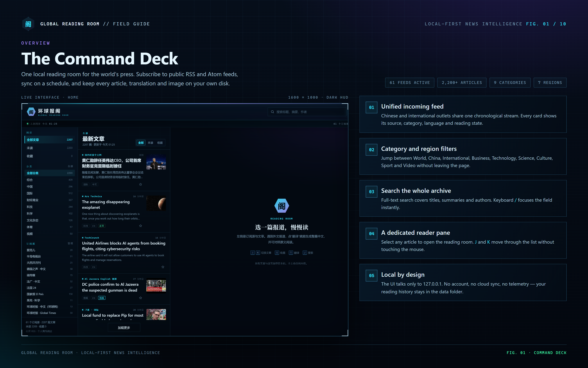
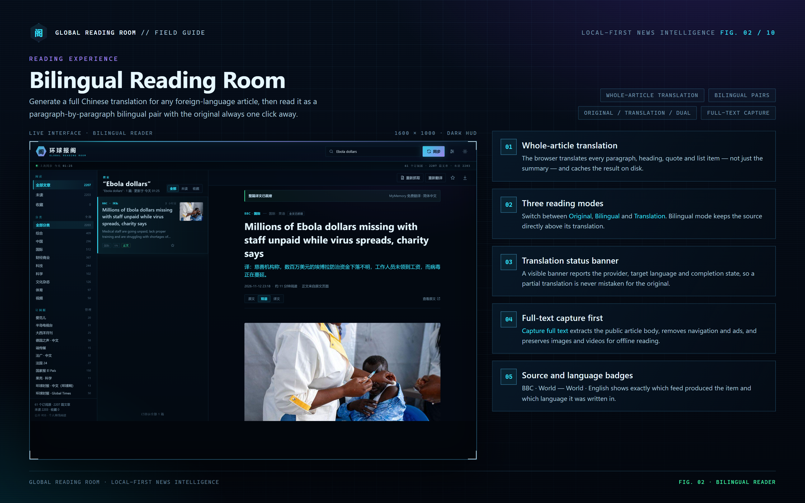
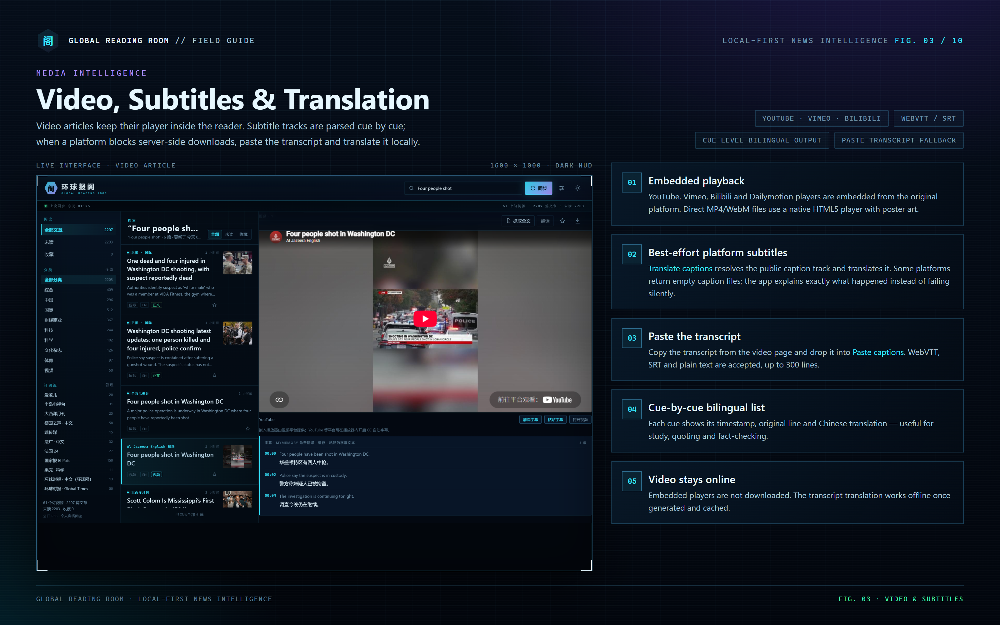
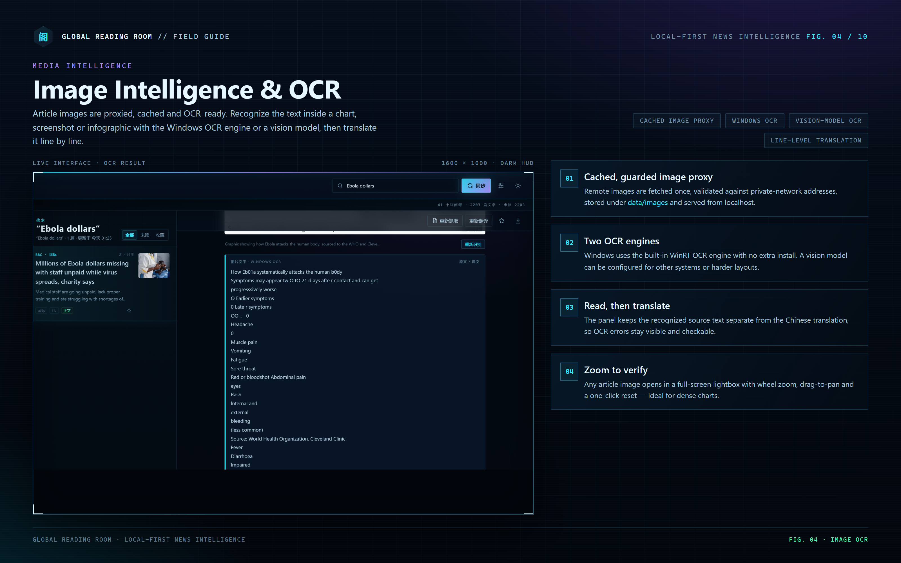
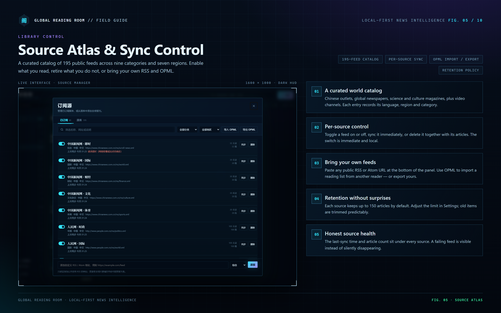
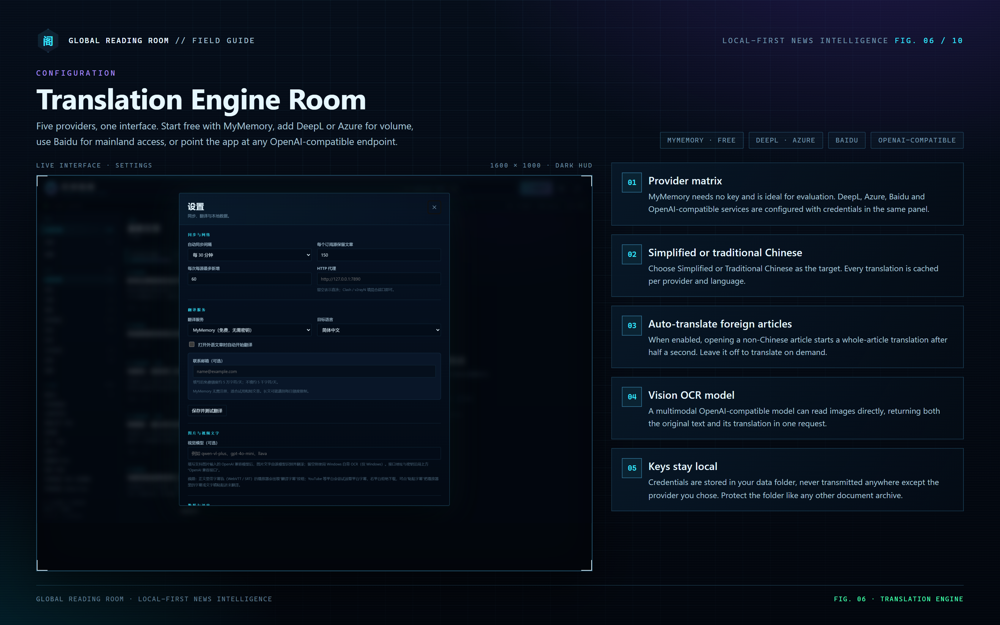
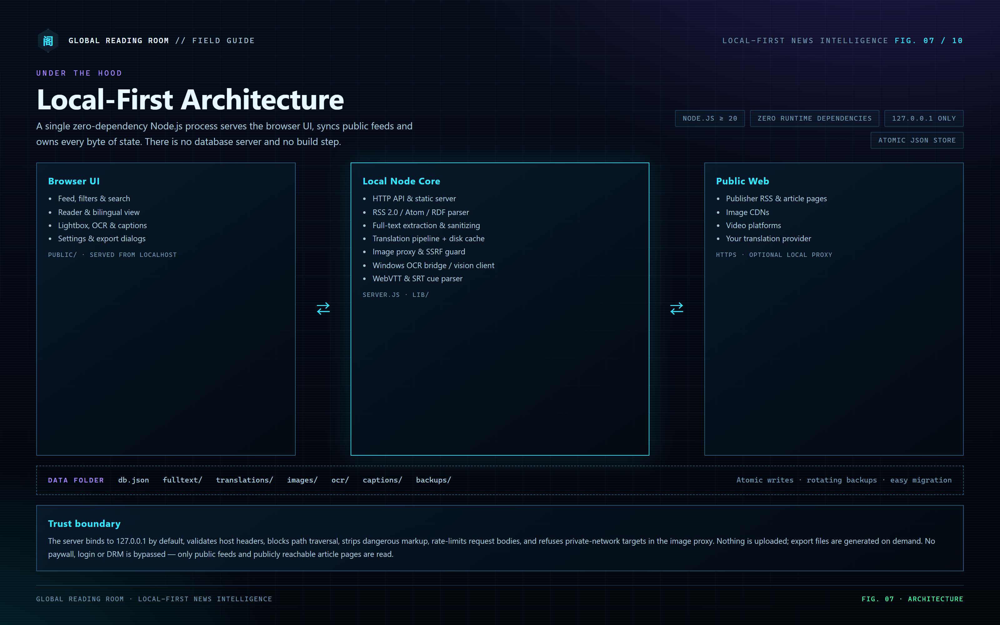
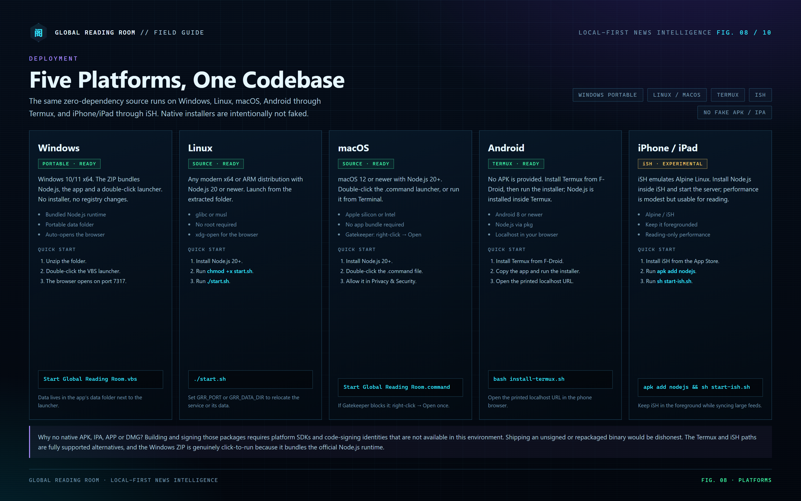
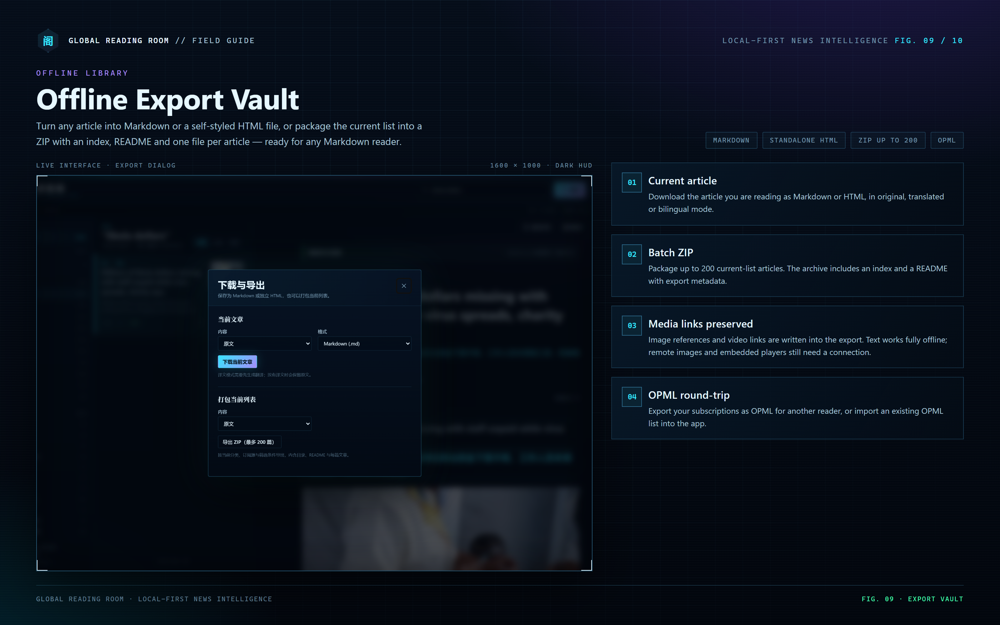
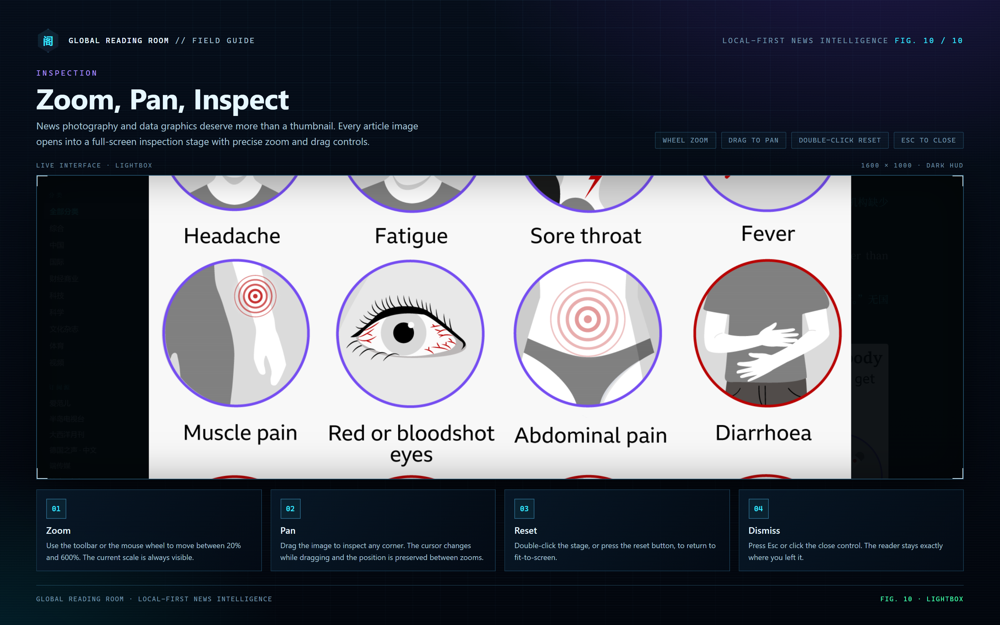

# Global Reading Room · 环球报阁

**A local-first news and magazine reading room for the world's press.**  
Public RSS and Atom in, full Chinese translations, offline exports, image OCR and subtitle translation out — all on your own machine.

Version 1.0.0 · Node.js ≥ 20 · Windows · Linux · macOS · Android (Termux) · iPhone / iPad (iSH)

---

## Download

**Windows 10 / 11 users:** [**download the portable Windows ZIP**](downloads/windows/global-reading-room-1.0.0-windows-x64.zip), unzip it, then double-click **`Start Global Reading Room.vbs`**. No installer, no admin rights, Node.js is bundled.

| Platform | Package | Launcher |
| --- | --- | --- |
| **Windows 10 / 11 (x64)** | [Windows ZIP](downloads/windows/global-reading-room-1.0.0-windows-x64.zip) | `Start Global Reading Room.vbs` |
| **Linux** | [Linux tar.gz](downloads/linux/global-reading-room-1.0.0-linux.tar.gz) | `start.sh` |
| **macOS 12+** | [macOS tar.gz](downloads/macos/global-reading-room-1.0.0-macos.tar.gz) | `Start Global Reading Room.command` |
| **Android — Termux** | [Termux ZIP](downloads/android-termux/global-reading-room-1.0.0-termux.zip) | `install-termux.sh` |
| **iPhone / iPad — iSH** | [iSH ZIP](downloads/iphone-ipad-ish/global-reading-room-1.0.0-ish.zip) | `start-ish.sh` |

Each platform folder contains its own `README.md` and `SHA256.txt`. All hashes are also in [`downloads/SHA256SUMS.txt`](downloads/SHA256SUMS.txt). The same five packages are attached to the [GitHub v1.0.0 release](https://github.com/IAMMEZSH/global-reading-room/releases/tag/v1.0.0).



---

## Why this exists

Most news readers either send your reading history to a cloud account or lock the good parts behind a subscription. Global Reading Room takes the opposite approach:

- **Public sources only.** It reads public RSS / Atom feeds and publicly reachable article pages. It does not bypass paywalls, logins or DRM.
- **Everything is local.** The server binds to `127.0.0.1`; articles, translations, images, OCR output, subtitles and backups live in one folder you can copy or delete.
- **Chinese first.** Foreign articles can be translated paragraph by paragraph, with the original always one click away.
- **Media aware.** Article images are cached and zoomable; image text can be recognized and translated; video pages can parse subtitle tracks or accept a pasted transcript.
- **No installer, no runtime dependencies.** The Windows portable build bundles the official Node.js runtime. The same zero-dependency source runs on Linux, macOS, Termux and iSH.

---

## Feature map

| Area | What you get |
| --- | --- |
| **Feed engine** | Custom RSS 2.0 / Atom / RDF parser, conditional requests, per-source sync, scheduled sync, unread and starred views, full-text search, nine categories and seven regions |
| **Source atlas** | 195 public feeds in the catalog; 61 enabled on first run; Chinese and international outlets, newspapers, magazines, science, culture and video channels |
| **Reading room** | Three-pane desktop layout, mobile drawer layout, `J` / `K` article navigation, `S` star, `T` translate, `/` search |
| **Full text** | Public article extraction, navigation/ad stripping, image proxy and cache, media discovery, safe HTML rendering |
| **Translation** | MyMemory, DeepL, Azure, Baidu and any OpenAI-compatible endpoint; per-paragraph cache; simplified or traditional Chinese; original / bilingual / translation modes |
| **Images** | Guarded image proxy, cached originals, full-screen lightbox, wheel zoom 20–600 %, drag-to-pan, double-click reset |
| **Image OCR** | Windows built-in WinRT OCR with no extra install; optional OpenAI-compatible vision model on any platform; recognized text and line-level Chinese translation kept side by side |
| **Video** | YouTube, Vimeo, Bilibili and Dailymotion embeds; direct MP4/WebM playback; WebVTT / SRT parsing; cue-level bilingual output; paste-transcript fallback when a platform blocks caption downloads |
| **Offline library** | Current article as Markdown or standalone HTML in original, translated or bilingual mode; batch ZIP of up to 200 list articles with index and README; OPML import / export |
| **Data** | Atomic JSON writes, `.bak` safety copy, seven rotating daily backups, portable data folder, one-click shutdown |
| **Security** | Localhost-only bind, host and origin checks, CSP, path-traversal protection, request-size limits, SSRF guard on image and caption fetches |

---

## The field guide

Ten full-resolution English plates explain the interface, the architecture, the platform paths and the media pipeline. They are also installed with the app and embedded in the manual.

### 01 · Command deck


### 02 · Bilingual reading room


### 03 · Video, subtitles and translation


### 04 · Image intelligence and OCR


### 05 · Source atlas and sync control


### 06 · Translation engine room


### 07 · Local-first architecture


### 08 · Five platforms, one codebase


### 09 · Offline export vault


### 10 · Zoom, pan, inspect


The complete operating manual — installation, every setting, provider setup, OCR, captions, backups, API, troubleshooting and the legal boundary — is in **[MANUAL.html](MANUAL.html)**.

---

## Quick start

Package choices and checksums are listed in [Download](#download) at the top of this page.

### Windows 10 / 11 (x64) — portable, click to run

1. Extract `global-reading-room-1.0.0-windows-x64.zip`.
2. Open the extracted folder.
3. Double-click **`Start Global Reading Room.vbs`**.

The bundled runtime starts the server, the default browser opens `http://127.0.0.1:7317`, and the first sync begins automatically. Nothing is installed and no registry keys are written. To see console output, use `Start Global Reading Room (console).cmd` instead.

Data lives in `data\` next to the launcher. To move the app, move the whole folder.

### Linux

Requires Node.js 20 or newer.

```bash
tar -xzf global-reading-room-1.0.0-linux.tar.gz
cd global-reading-room-1.0.0
chmod +x start.sh
./start.sh
```

The browser opens automatically when a desktop session is available. On a headless machine use `./start.sh --no-open` and visit the printed address.

### macOS 12+

Requires Node.js 20 or newer (`brew install node`).

1. Extract `global-reading-room-1.0.0-macos.tar.gz`.
2. Double-click **`Start Global Reading Room.command`**.
3. If Gatekeeper blocks it, right-click → **Open** once.

### Android — Termux (no APK)

Install **Termux** from F-Droid, then:

```bash
unzip global-reading-room-1.0.0-termux.zip -d global-reading-room
cd global-reading-room
bash install-termux.sh
```

The installer installs `nodejs` inside Termux, starts the server and prints a `http://127.0.0.1:7317` address to open in the phone browser. An APK is intentionally not supplied; see [Platform honesty](#platform-honesty).

### iPhone / iPad — iSH (experimental)

In iSH:

```sh
apk add nodejs unzip
unzip global-reading-room-1.0.0-ish.zip -d global-reading-room
cd global-reading-room
sh start-ish.sh
```

Keep iSH in the foreground while syncing. Large feeds and full-text extraction are slow under emulation.

---

## First ten minutes

1. **Let the first sync finish.** The status strip at the top reports each feed. A slow feed is named, not silently skipped.
2. **Pick a category** in the left rail: 综合, 中国, 国际, 财经商业, 科技, 科学, 文化杂志, 体育, 视频.
3. **Open a foreign article.** Press `T` or click **翻译**. The whole article is translated, not just the summary.
4. **Switch reading mode** with 原文 / 双语 / 译文. Bilingual mode keeps each source paragraph above its translation.
5. **Click 抓取全文** if the feed only supplied a summary. The reader extracts the public article body, keeps images and videos, and then enables translation.
6. **Click any image** to open the lightbox. Wheel to zoom, drag to pan, double-click to reset, `Esc` to close.
7. **Open 设置** to choose a translation provider, a target language, a proxy, or an OCR vision model.
8. **Open 订阅源** to enable more of the 195-feed catalog, add a custom RSS URL, or import an OPML list.
9. **Use the download icon** to save the current article as Markdown or HTML, or to build a ZIP of the current list.
10. **Back up the `data` folder** before moving the app to another machine.

---

## Sources: what is really included

The catalog contains **195 public feeds**. **61 are enabled on a fresh install**, covering Chinese and international newspapers, wire services, business and technology publications, science and culture magazines, and video channels.

Some Chinese outlets no longer publish a working official RSS feed. For those the catalog uses **Bing News public RSS** as a discovery layer and unwraps each item to the publisher's direct article URL. The source entry says so in its note. This is still public RSS, but it is aggregation rather than a first-party feed; if an outlet restores an official feed, add it as a custom source.

Outlets without any public RSS — for example Zhihu, Xiaohongshu and Douyin — are **not** included. Adding them would require login, private APIs or anti-bot bypass, which this project will not do.

---

## Translation providers

| Provider | Key required | Notes |
| --- | --- | --- |
| **MyMemory** | No | Free evaluation default. Add a contact email to raise the daily allowance; long articles can hit the limit. |
| **DeepL** | Yes | Free keys ending in `:fx` automatically use the free endpoint. Good news-register quality. |
| **Azure Translator** | Yes + region | Free tier available. Region is required for multi-service resources. |
| **Baidu Translate** | APPID + key | Enable 通用文本翻译 in the Baidu console. Useful for mainland network conditions. |
| **OpenAI-compatible** | Depends | DeepSeek, Qwen, Moonshot, local Ollama and any `/chat/completions` service. Presets are in Settings. |

Translations are cached per article, provider and target language under `data/translations/`. Reopening an article does not spend quota again. Use **重新翻译** to force a fresh pass.

---

## OCR and subtitles in one paragraph each

**OCR:** Windows uses the built-in WinRT OCR engine through PowerShell, so no Tesseract install is needed. On Linux, macOS, Termux and iSH, configure an OpenAI-compatible vision model in Settings; the same model returns the source text and its translation. Recognized text is cached under `data/ocr/`.

**Subtitles:** Video articles keep the platform player. When a WebVTT or SRT track is available, **翻译字幕** parses and translates it cue by cue. YouTube frequently refuses server-side caption downloads; the app then explains the refusal and offers **粘贴字幕**, where you can paste the transcript (WebVTT, SRT or plain text, up to 300 lines) for local translation. The result is cached under `data/captions/`.

Embedded players are never downloaded. Direct MP4/WebM files play in the native HTML5 player.

---

## Data folder

```
data/
  db.json                  sources, article index, settings, read/star state
  db.json.bak              previous good copy
  backups/db-YYYY-MM-DD.json   seven rotating daily backups
  fulltext/<id>.json       extracted article bodies and media
  translations/<id>.<provider>.<lang>.json
  images/                  cached article images
  ocr/<hash>.json          OCR results
  captions/<hash>.json     parsed and translated subtitle cues
```

Copy the entire folder to migrate. Delete it to start clean. The app never writes outside this folder except temporary files used by the Windows OCR bridge.

---

## Security model

- The HTTP server listens on **`127.0.0.1` only** and validates the `Host` and `Origin` headers.
- Static file serving is allow-listed; path traversal is rejected.
- The UI runs under a restrictive Content-Security-Policy; scripts are same-origin only.
- Remote images are fetched through a proxy that resolves DNS and refuses loopback, link-local and private-network targets.
- Request bodies have explicit size limits; article HTML is sanitized before rendering.
- Credentials are stored in `db.json` inside the data folder. They are sent only to the provider you configure.
- Export files are generated on demand; nothing is uploaded anywhere.

The server is a personal reading tool, not a multi-user service. Do not expose it to a LAN or the public internet.

---

## HTTP API (local)

All endpoints are under `http://127.0.0.1:7317/api`. They are used by the bundled UI and are useful for scripts.

| Method | Path | Purpose |
| --- | --- | --- |
| GET | `/api/health` | Liveness probe |
| GET | `/api/state` | Settings, stats, categories, regions, source health, jobs |
| GET | `/api/catalog` | Full 195-feed catalog |
| GET | `/api/articles?view=&category=&sourceId=&q=&limit=&offset=` | Article list |
| POST | `/api/sync` | Start a sync (`{ "sourceId": "..." }` optional) |
| GET | `/api/jobs` | Recent background jobs |
| POST | `/api/sources` | Add a catalog or custom feed |
| PATCH / DELETE | `/api/sources/:id` | Enable, disable, retitle or delete a feed |
| POST | `/api/articles/:id/read` | Mark read / unread |
| POST | `/api/articles/:id/star` | Star / unstar |
| POST | `/api/articles/:id/fulltext` | Extract the public article body |
| POST | `/api/articles/:id/translate` | Start whole-article translation |
| GET | `/api/articles/:id/translation?provider=&lang=` | Read a cached translation |
| GET | `/api/articles/:id/download?format=md|html&mode=original|translation|bilingual` | Download one article |
| POST | `/api/export` | Build a batch ZIP |
| GET / POST | `/api/opml` | Export or import subscriptions |
| POST | `/api/ocr` | OCR an image URL |
| POST | `/api/captions` | Parse and translate a caption track or pasted transcript |
| POST | `/api/settings` | Update settings |
| POST | `/api/translate/test` | Test the active provider |
| POST | `/api/shutdown` | Stop the server |

---

## Project layout

```
server.js              HTTP server, API, job orchestration
lib/rss.js             RSS 2.0 / Atom / RDF parsing and sync
lib/sources.js         the 195-feed catalog
lib/extract.js         article extraction and sanitizing
lib/http.js            HTTP client, proxy, SSRF-aware fetching
lib/translate.js       providers, batching and cache
lib/ocr.js             Windows OCR bridge and vision client
lib/captions.js        WebVTT and SRT parsing
lib/imagecache.js      image proxy and disk cache
lib/exporters.js       Markdown, HTML, ZIP and OPML
lib/store.js           atomic JSON store, retention, backups
public/                the zero-framework browser UI
docs/explainers/       source pages for the ten field-guide plates
docs/images/           all screenshots and plates
```

---

## Platform honesty

This repository deliberately does **not** ship a native APK, IPA, APP or DMG. Producing and signing those requires platform SDKs and code-signing identities that are not available in this environment. Shipping an unsigned or repackaged binary would be dishonest.

What is supplied instead:

- a genuine click-to-run **Windows portable ZIP** with the official Node.js runtime;
- a **Linux tarball** with an executable launcher;
- a **macOS tarball** with a `.command` launcher;
- an **Android Termux installer** that installs Node inside Termux;
- an **iSH script** for iPhone and iPad.

Each path runs exactly the same source.

---

## Known limitations

- A feed can fail transiently. The source manager names the failing feed; retry from the row menu. One slow Chinese feed may occasionally time out during a full sync without affecting the others.
- Some publishers serve different HTML to data-center IPs, or require JavaScript. Full-text extraction may fail on those pages; the original link remains available.
- MyMemory is free but rate-limited. Long articles and repeated re-translation can be throttled.
- YouTube often blocks server-side caption downloads. The paste-transcript path is the supported fallback.
- OCR accuracy depends on image resolution. The OCR panel deliberately keeps the raw recognized text so errors stay visible.
- iSH is emulated and slow. It is suitable for reading, not for syncing dozens of large feeds.
- The interface language is Chinese; all documentation and field-guide plates are English, as requested.

---

## Legal and content rights

Global Reading Room is a personal offline reader. It aggregates **public RSS/Atom feeds and publicly accessible article pages**. It does **not** bypass paywalls, login walls, DRM or anti-bot systems, and it does **not** redistribute copyrighted articles. Downloaded files are for your own reading and research.

Copyright in every article, image and video remains with the original publisher and authors. Respect each outlet's terms of use. If you are a rights holder and believe a feed should not be listed, remove it from the catalog or contact the maintainer.

---

## Troubleshooting in thirty seconds

| Symptom | Fix |
| --- | --- |
| Browser does not open | Visit `http://127.0.0.1:7317` manually. On headless systems start with `--no-open`. |
| “Port 7317 is already in use” | Close the other copy or set `GRR_PORT=7318` (Windows: `set GRR_PORT=7318`). |
| A feed shows an error | Open 订阅源 → find the source → 同步. Transient timeouts usually clear on retry. |
| Translation stops partway | Check the provider quota and the proxy. Use 重新翻译; cached paragraphs are reused. |
| OCR button does nothing | On non-Windows systems, configure a vision model. On Windows, confirm the OCR language pack is installed. |
| Captions refuse to download | Use 粘贴字幕 and paste the transcript from the video page. |
| Blank page after an update | Hard-refresh (`Ctrl+F5`). The server serves only the current UI files. |
| Need to move to a new PC | Copy the whole app folder **and** its `data` folder. |

The full manual has a longer troubleshooting matrix, provider setup walkthroughs and API examples: **[MANUAL.html](MANUAL.html)**.

---

## Credits

Built as a single zero-dependency Node.js application. The Windows portable build redistributes the official Node.js runtime under the Node.js license; no other third-party libraries are bundled. All field-guide plates and interface screenshots were produced from the running application.

**Global Reading Room · 环球报阁** — read the world, keep it local.
